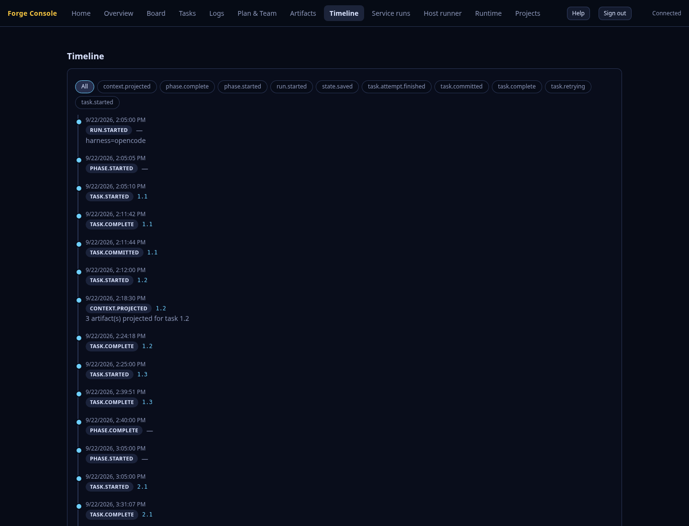
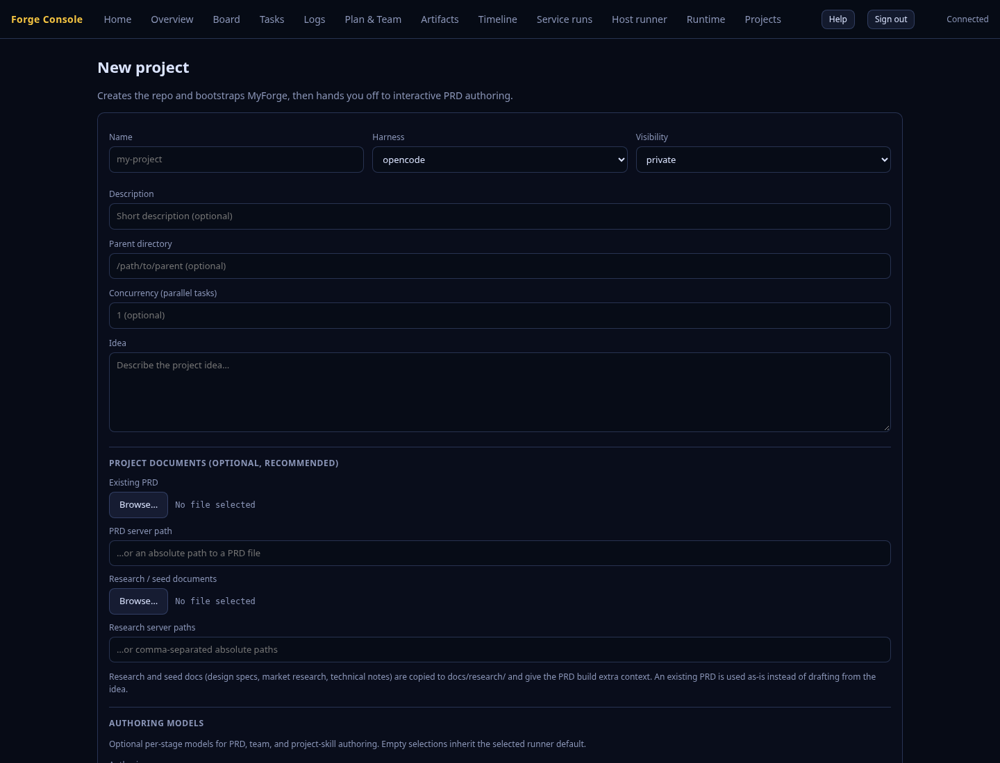
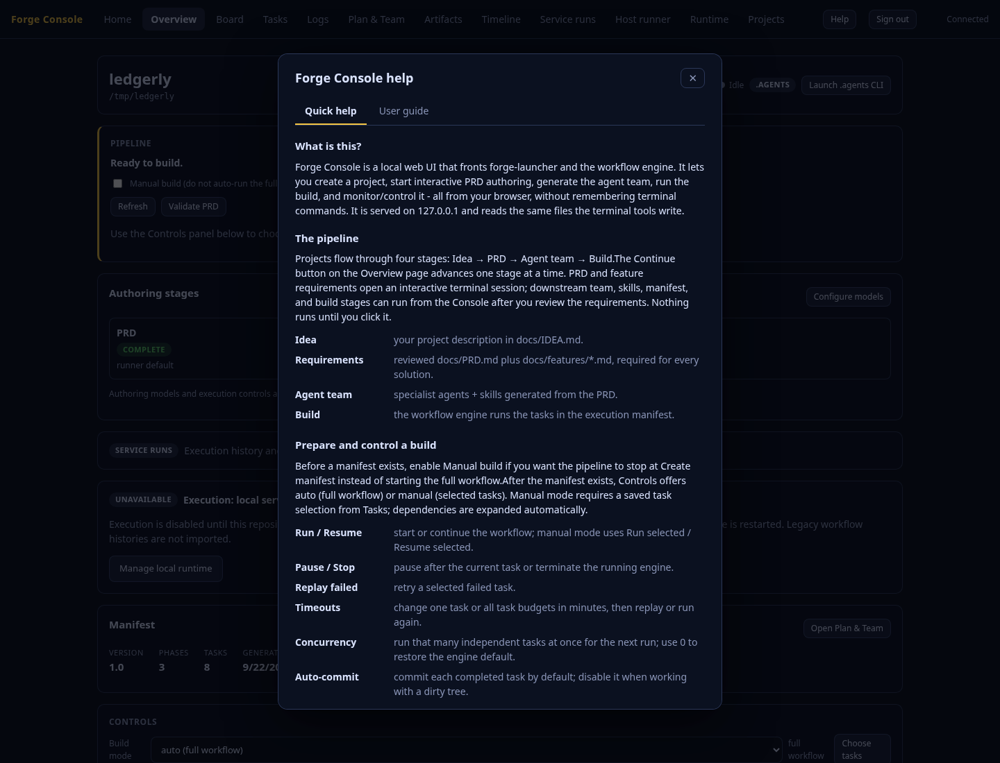
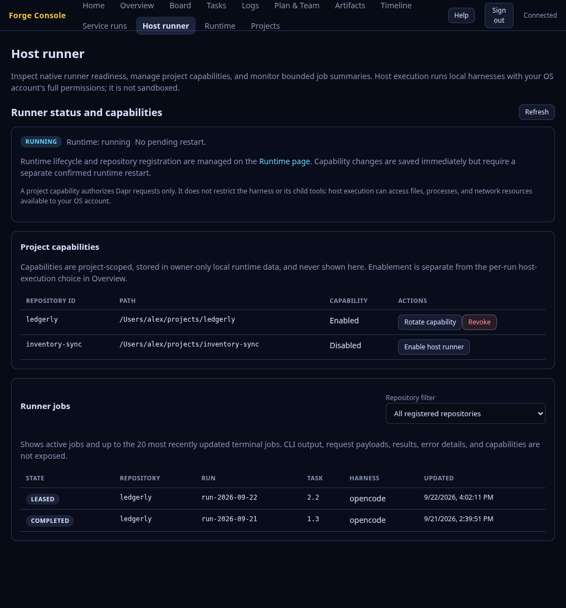

# Forge Console - Visual Tour

A screenshot walkthrough of the Forge Console. These images were captured from
the current Console build in Chrome against a deterministic local fixture; no
external authoring or paid model execution was used. Desktop captures use the
stable numbered filenames below. The complete desktop and responsive capture
set is archived under `images/forge-console/current/`. Start with
`forge-launcher console`.

> See [forge-console.md](forge-console.md) for the full reference.
>
> **Host runner (v3.147):** the captures include the dedicated capability and
> queue-monitoring page. Its status and job rows come from a deterministic
> screenshot fixture; they are not live runtime or provider data.

---

## 1. Home

The landing page. Two action cards - **Create a new project** (→ `#/new`) and
**Open an existing project** (→ `#/projects`) - plus a **Recent projects**
dropdown for one-click return to a prior project.


## 2. Overview

The dashboard puts project identity, the next pipeline action, and blockers
first. PRD, team, and project-skill authoring have separate status and model
summaries. The **Controls** panel holds run controls, the per-run **Executor**
selector, per-task timeouts, the **Auto-commit** and **Log harness activity**
toggles, concurrency, and the feature-increment form. Authoring retries are
distinct from native execution controls; legacy projects do not need to
regenerate a team just to resume a build. (The Overview capture is full-page so
the Controls are visible.)


## 3. Board

The PixiJS **Forge Board**, embedded full-screen, in one of two modes.

**Kanban** — tasks as name-tag cards flowing through **To Do · In Progress ·
Done · Failed**, grouped by phase.


**Gantt** — the same run against time on its dependencies. Filled bars are
measured, outlined hatched bars are forecast; phase rollups span each phase, the
critical path is outlined in gold, and the axis follows the local clock. The
forecast continues from where the run last did something, so a stale run stays on
its own window instead of stretching out to the present.


**Table** — the same data as a real table. The board is a canvas, so this is the
route for keyboard and screen-reader use.


## 4. Tasks

Every task appears in a sortable, filterable table with status chips, search,
and explicit manual selection. Selections and focused controls survive live
updates. On narrow screens, the labelled table region scrolls horizontally
instead of widening the whole page.


## 5. Task detail

Clicking a row expands a detail drawer: description, expected outputs, validation
commands, dependencies, inputs, output files, and error/artifact metadata.


## 6. Logs (engine)

The `docs/forge.log` tail, live-appended over SSE. Follow mode keeps new
output in view; disabling it preserves the reading position and shows unread
output.


## 7. Logs (audit)

The audit event stream (run/phase/task lifecycle), also live.


## 8. Plan & Team

Independent PRD, team, and project-skill **Authoring models** are available
before a team exists. Save a model or leave a stage on **Inherit runner default**.
Inventory refresh and unavailable saved selections remain explicit. The
**Documents**, **Agents**, and **Skills** sections keep execution-model
overrides separate from authoring settings.


## 9. Plan & Team - a document

Expanding **Documents** and selecting the PRD opens it in a wide popup as
rendered Markdown (requirement and task blocks become tables), with an
**Open externally** button to edit it in your editor.


## 10. Timeline

Chronological audit events, with failures highlighted.



## 11. New project

The **New Project** wizard (`#/new`) collects project details, supported text
documents, and three optional authoring model choices. The wizard does not
auto-draft requirements; after creation, PRD authoring starts from Overview in
an interactive terminal session.
Selecting an existing PRD skips drafting it. Failed uploads or saves keep
the draft available rather than silently starting with missing inputs.



## 12. Help

The **Help** dialog explains the pipeline, views, and key terms. Opening it moves
keyboard focus into the dialog; Escape closes it and returns focus to Help.



## 13. Host runner

The **Host runner** view shows runner readiness, project-scoped capabilities,
and bounded active/recent job history. The operator view excludes capability
values, request/result payloads, CLI output, and raw failure details.



## Responsive current captures

The current build was captured at 1440px, 1024px, 720px, 390px, and 320px for
each responsive route in the visual tour. Detail-state captures (expanded task,
rendered PRD, rendered feature, and audit log) are also
included in `images/forge-console/current/`.

| View | 1024px | 720px | 390px | 320px |
| --- | --- | --- | --- | --- |
| Overview | [image](images/forge-console/current/overview-1024.png) | [image](images/forge-console/current/overview-720.png) | [image](images/forge-console/current/overview-390.png) | [image](images/forge-console/current/overview-320.png) |
| Board | [image](images/forge-console/current/board-1024.png) | [image](images/forge-console/current/board-720.png) | [image](images/forge-console/current/board-390.png) | [image](images/forge-console/current/board-320.png) |
| Tasks | [image](images/forge-console/current/tasks-1024.png) | [image](images/forge-console/current/tasks-720.png) | [image](images/forge-console/current/tasks-390.png) | [image](images/forge-console/current/tasks-320.png) |
| Logs | [image](images/forge-console/current/logs-1024.png) | [image](images/forge-console/current/logs-720.png) | [image](images/forge-console/current/logs-390.png) | [image](images/forge-console/current/logs-320.png) |
| Plan & Team | [image](images/forge-console/current/documents-1024.png) | [image](images/forge-console/current/documents-720.png) | [image](images/forge-console/current/documents-390.png) | [image](images/forge-console/current/documents-320.png) |
| Timeline | [image](images/forge-console/current/timeline-1024.png) | [image](images/forge-console/current/timeline-720.png) | [image](images/forge-console/current/timeline-390.png) | [image](images/forge-console/current/timeline-320.png) |
| Projects | [image](images/forge-console/current/projects-1024.png) | [image](images/forge-console/current/projects-720.png) | [image](images/forge-console/current/projects-390.png) | [image](images/forge-console/current/projects-320.png) |
| New project | [image](images/forge-console/current/new-1024.png) | [image](images/forge-console/current/new-720.png) | [image](images/forge-console/current/new-390.png) | [image](images/forge-console/current/new-320.png) |
| Host runner | [image](images/forge-console/current/host-runner-1024.png) | [image](images/forge-console/current/host-runner-720.png) | [image](images/forge-console/current/host-runner-390.png) | [image](images/forge-console/current/host-runner-320.png) |

## Regenerating these captures

The images are produced by the `tools/console-screenshots` developer tool. It
builds the launcher, writes a deterministic fixture repository, starts the
Console against it, and drives the installed Chrome with `puppeteer-core`. No
model or external authoring runs; every timestamp in the fixture is fixed.

```bash
cd tools/console-screenshots
npm install         # first time; installs puppeteer-core (no bundled browser)
npm run capture     # builds the launcher, captures, then writes images + GIF
```

Requirements: `google-chrome` (or set `CHROME_PATH`), `ffmpeg` on `PATH`, and
Node 18+. The tool writes the responsive set to
`docs/images/forge-console/current/`, derives the numbered tour images and the
640px thumbnails, and rebuilds `console-walkthrough.gif`. Pass `--headed` to
watch it run (useful if headless WebGL ever renders the Board blank).
