# Local Execution Architecture

> **Current architecture:** this guide describes how MyForge runs Dapr-backed
> service runs on an operator-managed local runtime. The pre-Dapr in-process
> workflow engine has been removed; it is not the current scheduler.

This is the system-level overview of the path from a compiled execution
manifest to verified repository changes. The launcher submits and observes
runs, Dapr owns durable orchestration, and a harness runner performs each task
attempt. Native host execution is the temporary default: it delegates each
attempt to the local host runner and the CLI installed on the operator's
machine. The worker container is an explicit opt-in.

For command syntax and runtime administration, see the
[launcher guide](forge-launcher.md). For required behavior, see the
[Dapr execution feature](features/dapr-execution-boundary.md) and the
[host-execution feature](features/local-host-harness-execution.md). The
[versioned execution contract](contracts/dapr-execution-v1.md) is normative
for contract fields and invariants.

## The execution path at a glance

```mermaid
flowchart LR
    A["PRD, features, agents"] --> B["Execution adapter"]
    B --> C["Execution manifest"]
    C --> D["Launcher service-run client"]
    D -->|authenticated loopback API| E["Dapr execution service"]
    E --> F["Dapr Workflow"]
    F --> G["Verified task activity"]
    G --> H{"Runner selected?"}
    H -->|default host mode| J["PostgreSQL runner queue"]
    H -->|explicit worker mode| I["Harness in worker container"]
    J --> K["Launcher-managed host runner"]
    K --> L["Local harness CLI"]
    I --> M["Result admission"]
    L --> N["Bounded workspace delta"]
    N --> M
    M --> O["Checkpoint, completion record and repository integration"]
    O --> R["Durable evidence: work, validation, Git bundle"]
    E --> P["Run status and lifecycle events"]
    D --> P
    Q["Forge Console"] --> P
    Q --> R
```

The principal responsibilities are:

| Part | Responsibility |
|---|---|
| Execution adapter | Validates authored requirements and compiles the manifest. |
| Launcher service-run client | Selects a registered repository, prepares a submission snapshot, calls the local service, and follows status. |
| Dapr execution service | Authenticates requests, validates and stores submissions, registers workflows and activities, and exposes run state and controls. |
| Dapr Workflow | Owns durable run/task scheduling, retries, waits, and control-event handling. |
| `ExecutionHost` | Executes task activities, supervises attempts, verifies outcomes, publishes checkpoints, and integrates accepted changes. |
| Worker harness runner | Invokes the selected harness in the worker container; explicit opt-in mode. |
| Native host runner | Polls the service for jobs and invokes the locally installed harness; temporary default mode. |
| Completion ledger | Records integrated tasks and their artifact refs so later runs can replay completed work. |
| Forge Console | Projects authoring, live service-run state, and durable evidence; it is an operator client, not an execution authority. |

## A run from source to result

1. Requirements and agent instructions are authored in the target repository.
   The execution adapter validates them and writes
   `docs/EXECUTION-MANIFEST.json`.
2. `forge-launcher run` or `forge-launcher service submit` resolves the
   registered repository and selected harness. The launcher prepares an
   immutable submission snapshot, including the manifest digest, target
   `forge/<base>` branch, task selection, settings, and workflow-definition
   version.
3. The launcher sends the snapshot to the authenticated local execution
   service. The service validates repository and target-ref ownership,
   supported harness configuration, task selection, and configured run bounds.
   It persists the accepted submission before scheduling the Dapr run workflow.
4. Dapr Workflow schedules ready tasks and records durable waits, retries, and
   controls. Each task attempt is dispatched to an activity hosted by
   `ExecutionHost`.
5. The activity prepares a disposable workspace and chooses a runner from the
   accepted run settings. In worker mode, the activity invokes the selected
   adapter locally in the worker. In host mode, it submits a typed request to
   a durable PostgreSQL queue and waits for the host runner to return the
   result.
6. The activity applies the same output, no-op, structured-result, and
   validation gates to either execution mode. Missing project dependencies are
   installed before validation, and validation evidence is recorded once. Accepted
   changes are checkpointed, recorded in the completion ledger, and integrated
   into the run's Forge branch. The service publishes run status and lifecycle
   events for launcher and Console clients.
7. A later run whose target head already contains an integrated task replays its
   completion, hydrates the work artifact for dependants, and skips the harness
   call. The Console reads the completion ledger through the authenticated
   evidence API.

The checked-out branch is not used as the service run's integration target.
Run changes are committed to the run's `forge/<base>` branch; use the service
merge operation to fast-forward the checked-out branch when appropriate.

### How repository changes reach a run

The service does not watch, poll, or rescan registered repositories. It only
knows the requirements compiled into a submission, so a feature increment
becomes visible to Dapr when the launcher submits a new run, not when the
documents are written.

- Authoring tools read and write the working tree directly. The service never
  reads `docs/PRD.md` or `docs/features/`.
- `forge-launcher run` and `service submit` snapshot the compiled manifest and
  agent descriptions into the run. Editing the repository after submission does
  not change the in-flight run; submit again to execute new work.
- Only the registered repository's `.git` directory is mounted. New commits need
  no re-registration; a new repository path needs
  `forge-launcher runtime repo add` and a runtime restart.
- A later run replays integrated tasks from the completion ledger by repository
  and task ID. New task IDs start pending, and a task executes again when its
  validation commands or expected outputs no longer match the recorded
  completion.
- The manifest comes from the working tree, while task workspaces clone the
  committed `forge/<base>` tip. Merge a completed run back before the next
  increment, or the new tasks execute against code that does not contain the
  previous run's commits. See
  [Long-running projects](long-running-projects.md#phase-completion-and-the-source-repository).

## Worker mode and host mode

| | Native host mode (temporary default) | Worker mode (explicit) |
|---|---|---|
| Harness process | Runs on the machine that manages the runtime. | Runs in the local runtime's worker container. |
| Selection | Used when no explicit worker setting is present; the service also requires a capability for that repository. | `--worker-execution`, the Console **Worker container** choice, or `executor: "worker"` in engine config. |
| Provider authentication | Uses that local CLI's normal host authentication. | Uses credentials granted to the runtime for the selected harness. |
| Workspace handoff | The host runner clones the registered repository at the accepted base revision, runs in a disposable attempt workspace, and returns a bounded binary Git diff. | The worker activity operates on its managed workspace. |
| Validation | Runs beside the harness in the disposable clone before the delta is returned; the service trusts that evidence. | Runs in the worker after installing missing project dependencies; one evidence record is published. |
| Permissions | The harness and its child tools run with the operator's normal OS permissions; there is no task sandbox. | Constrained by the worker container's runtime configuration. |

The runner choice changes where the harness process runs; it does not transfer
workflow ownership. Dapr remains responsible for scheduling, timeouts,
validation, checkpoint publication, cancellation, and repository integration.
Host mode never silently falls back to the worker harness.

Selection is per run and explicit, but the temporary local default is native
host execution. `--worker-execution` and the Console's **Worker container**
choice opt into the worker; an explicit `executor: "worker"` in
`docs/engine-config.json` is also honored. An absent executor setting means
host. The Console checks project registration, runner capability, and runner
readiness before submitting a host request; the service remains authoritative
and still rejects an unavailable host runner with `harness-unavailable`. Host
mode never silently falls back to the worker. See
[Long-running projects](long-running-projects.md) for phase-gated operation.

The host-runner capability authorizes Dapr-to-runner requests for one
registered repository. It is distinct from provider credentials, the service
API token, Dapr sidecar authentication, and Git credentials. It does not limit
the local harness's OS permissions or restrict it to the task workspace.

## Runtime and authority

The launcher manages the local Podman deployment, including PostgreSQL, the
Dapr sidecar and workflow dependencies, and the Forge worker. The service API
is exposed on loopback and protected by a bearer token. The host runner makes
outbound polling requests to that service; it does not expose a remote listener.

Each store has a specific role:

- **Dapr Workflow history** is the durable orchestration record.
- **PostgreSQL application records** hold accepted submissions, run/task
  status, controls, ownership and receipts, and durable host-runner jobs.
- **File-backed completion ledger, artifacts, and checkpoints** hold integrated
  task records, validated evidence, and workspace snapshots.
- **Local runtime data** holds operator credentials, host-runner capabilities,
  and the activity/runtime logs with restrictive file permissions where
  supported.

Old `docs/WORKFLOW-STATE.json`, `docs/engine-control.json`, `docs/engine.pid`,
and `docs/engine-run.log` files are ignored for execution and are not current
authority. The service reconstructs its in-memory run bindings from accepted
submissions when it starts.

## Operational entry points

- Use `forge-launcher runtime` to start, stop, inspect, and configure the local
  runtime and registered repositories.
- Use `forge-launcher run` or `forge-launcher service` to submit, follow,
  inspect, and control service runs.
- Use the Forge Console's **Service runs** view for run-level monitoring and
  controls, per-attempt **Activity** for opt-in worker harness output, its
  **Evidence** view for durable work/validation/bundle artifacts, and its
  **Host runner** view for runner readiness, capabilities, and bounded job
  summaries. **Activity log**, **Runtime log**, and **Run events** are separate
  live sources. See [Git bundle evidence](git-bundle-evidence.md) for what a
  downloaded checkpoint bundle contains and when to use it.

The [launcher guide](forge-launcher.md) documents commands and options. The
[Console user guide](forge-console-user-guide.md) documents the operator
workflow. This architecture overview intentionally does not duplicate those
procedures.

## Related documentation

- [Dapr execution feature and requirements](features/dapr-execution-boundary.md)
- [Native host-execution feature and requirements](features/local-host-harness-execution.md)
- [Dapr execution contract v1](contracts/dapr-execution-v1.md)
- [Forge Launcher command guide](forge-launcher.md)
- [Forge Console user guide](forge-console-user-guide.md)
- [ADR-066: Dapr workflow replacement architecture](adr/066-dapr-workflow-full-replacement-architecture.md)
- [ADR-069: service-run submission and repository binding](adr/069-service-run-submission-and-repository-binding.md)
- [ADR-071: service harnesses and execution entry points](adr/071-service-harnesses-and-execution-entry-points.md)
- [ADR-081: Native local harness execution without task sandbox](adr/081-native-local-harness-execution-without-task-sandbox.md)
- [ADR-079: Dapr execution cutover](adr/079-dapr-execution-cutover.md)
- [ADR-087: Runtime evidence and live Console activity](adr/087-runtime-evidence-and-live-console.md)
- [ADR-088: Remove the pre-Dapr legacy engine](adr/088-remove-pre-dapr-legacy.md)
- [Code-grounded local execution deep dive](local-execution-deep-dive.md)
